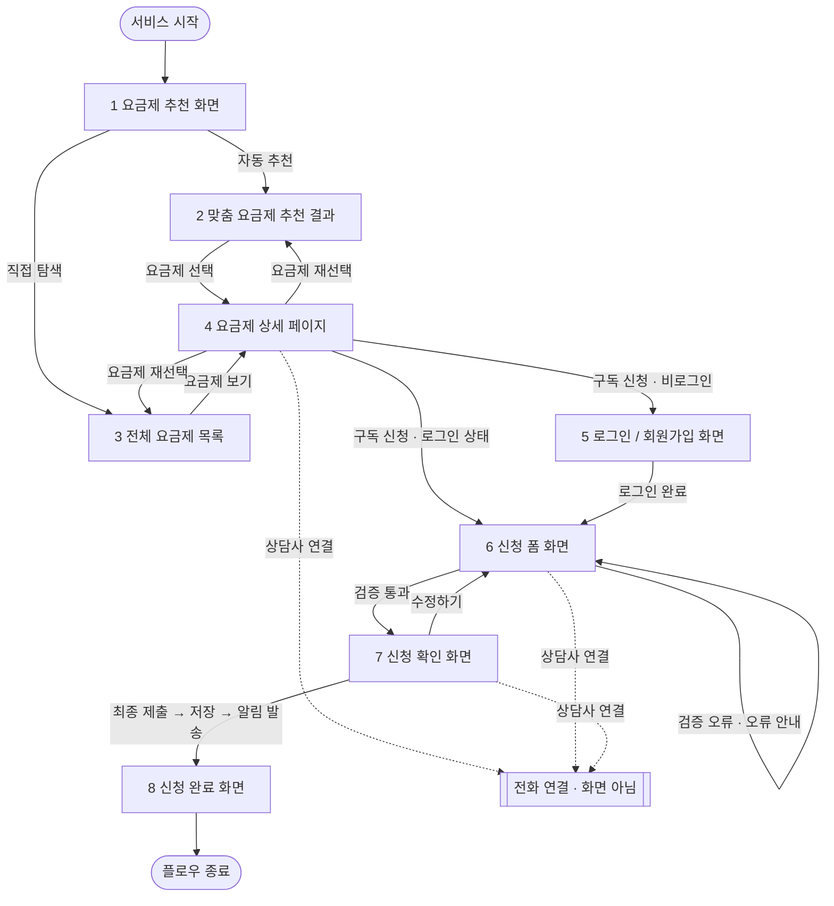

# 26-10-21 Screen-spec — 화면 명세

기준 자료: PRD.md, screens.md, design.md, flow.png (기준 순서: links.md)
표시: [확인 필요] 문서로 확인 안 됨 · [제안] 직접 제안한 값 · [불일치] 문서끼리 다름

- 기준 순서 (links.md): PRD.md > screens.md > 화면 링크 > Make 링크 > flow.png
- design.md는 컴포넌트 이름·변형을 맞출 때만 사용했다.
- Figma 링크(화면 링크, Make 링크)는 읽지 않았다.
- 화면 목록은 screens.md의 `##` 제목 순서를 그대로 따른다. PRD.md와 화면 구성이 다른 점은 아래 "확인 필요 · 제안 · 불일치 모음"의 M1~M4에 정리했다.
- 고객 개인정보가 들어 있는 예시 값은 옮기지 않고 항목명으로만 적었다.

## 전체 요약

| # | 화면 | 라우트 | 들어오는 곳 | 나가는 곳 |
|---|---|---|---|---|
| 1 | 요금제 추천 화면 | `/recommend` [제안] | 서비스 시작 (첫 화면) | 자동 추천 → 2 · 직접 탐색 → 3 |
| 2 | 맞춤 요금제 추천 결과 | `/recommend/result` [제안] | 1 (자동 추천) · 4 (요금제 재선택) | 요금제 선택 → 4 |
| 3 | 전체 요금제 목록 | `/plans` [제안] | 1 (직접 탐색) · 4 (요금제 재선택) | 요금제 보기 → 4 |
| 4 | 요금제 상세 페이지 | `/plans/[id]` [제안] | 2 (요금제 선택) · 3 (요금제 보기) | 구독 신청 + 비로그인 → 5 · 구독 신청 + 로그인 상태 → 6 · 요금제 재선택 → 2 또는 3 · 상담사 연결 → 전화 연결 (화면 아님) |
| 5 | 로그인 / 회원가입 화면 | `/login` [제안] | 4 (구독 신청 + 비로그인) | 로그인 완료 → 6 |
| 6 | 신청 폼 화면 | `/apply` [제안] | 4 (구독 신청 + 로그인 상태) · 5 (로그인 완료) · 7 (수정하기) | 검증 통과 → 7 · 검증 오류 → 6 (오류 안내 후 입력 수정) · 상담사 연결 → 전화 연결 (화면 아님) |
| 7 | 신청 확인 화면 | `/apply/confirm` [제안] | 6 (검증 통과) | 수정하기 → 6 · 최종 제출 (저장 → 알림 발송) → 8 · 상담사 연결 → 전화 연결 (화면 아님) |
| 8 | 신청 완료 화면 | `/apply/complete` [제안] | 7 (최종 제출 → 저장 → 알림 발송) | 플로우 종료 |

- 목적지가 문서에 없는 이동(뒤로 버튼, 취소, 요금제 더 보기 등)은 표와 흐름도에 넣지 않고 화면별 "이동"에 [확인 필요]로 적었다.

## 화면 이동 흐름

- 점선은 화면 이동이 아닌 외부 전화 연결이다. (PRD.md · 공통 [상담사 연결] FC-2, R9)

---

## 1. 요금제 추천 화면

목적: 요금제를 확인할 방식을 선택한다. (screens.md · 요금제 추천 화면 · 목적)

### 라우트
- `/recommend` [제안] — 문서에 경로 없음. (screens.md · 요금제 추천 화면 · 라우트)

### 구성 요소
- 구성 요소 전체 [확인 필요] — 디자인이 제공되지 않았고, 사용할 컴포넌트가 확정되지 않음. (screens.md · 요금제 추천 화면 · 구성 요소)
- 추천 방식 선택 (자동 추천 / 직접 탐색) — 상태와 이동에서 확인되는 선택지. (screens.md · 요금제 추천 화면 · 상태, 이동 / flow.png · 추천 방식 선택)
  - 컴포넌트로 `OptionItem (default / selected)`를 제안 [제안] — design.md는 질문형 추천처럼 하나를 고르는 흐름에 OptionItem을 쓰라고 함. (design.md · 4.8 OptionItem)
- [불일치] PRD.md의 첫 화면은 "내 이용 현황"(청구 금액·사용량·약정 정보, [맞춤 요금제 추천받기] 버튼)이며, 이 화면은 PRD.md에 없음. 두 화면이 같은 화면인지 [확인 필요]. → M2 (PRD.md · 6. 범위, 화면 1)

### 상태
- 기본: 추천 방식 선택. 자동 추천과 직접 탐색 분기가 있음. (screens.md · 요금제 추천 화면 · 상태)
- [확인 필요] 로딩: 정의 없음. (screens.md · 요금제 추천 화면 · 상태)
- [확인 필요] 빈 화면: 정의 없음. (screens.md · 요금제 추천 화면 · 상태)
- [확인 필요] 오류: 정의 없음. (screens.md · 요금제 추천 화면 · 상태)
- [확인 필요] 비활성: 선택 전 진행 가능 여부 정의 없음.

### 이동
- 들어오는 곳: 서비스 시작 (첫 화면). (screens.md · 요금제 추천 화면 · 이동 / flow.png · 서비스 시작)
- 나가는 곳:
  - 자동 추천 선택 → 2. 맞춤 요금제 추천 결과. (screens.md · 요금제 추천 화면 · 이동 / flow.png)
  - 직접 탐색 선택 → 3. 전체 요금제 목록. (screens.md · 요금제 추천 화면 · 이동 / flow.png)
  - [확인 필요] 뒤로가기 동작 정의 없음.

---

## 2. 맞춤 요금제 추천 결과

목적: 자동 추천된 요금제를 확인하고 상세 화면으로 이동한다. (screens.md · 맞춤 요금제 추천 결과 · 목적)

### 라우트
- `/recommend/result` [제안] — 문서에 경로 없음. (screens.md · 맞춤 요금제 추천 결과 · 라우트)

### 구성 요소
- [확인 필요] 화면 디자인이 제공되지 않음. 추천 목록 구성, 추천 기준, 표시 항목 미정. (screens.md · 맞춤 요금제 추천 결과 · 구성 요소)
- 아래는 PRD.md 요구사항으로 확인되는 요소다. 기준 순서에 따라 PRD.md를 적용했다. → M7
  - 요금 상한액 입력 — 통신·구독 요금제 요금을 모두 포함. 미납·체납 고객에게는 먼저 권하고 기본값은 최근 3개월 평균 청구 금액. (PRD.md · 화면 2 · F2-1, F2-2)
    - 컴포넌트는 `Input` [제안] — 문서에 컴포넌트 지정 없음. (design.md · 4.2 Input)
  - 추천 조합 목록 — 상한액 안에 드는 통신 요금제 1개 + 구독 요금제 0~N개. (PRD.md · 화면 2 · F2-3)
    - 컴포넌트는 `Card/Plan (default / selected)` + `Tag`(추천 배지). design.md는 Card/Plan을 요금제 목록·추천 결과에 쓰고, Tag를 추천 배지에 쓴다고 함. (design.md · 4.6 Card/Plan, 4.12 Tag)
  - 추천마다 현재 요금, 종량제 기준 예상 요금과의 차액 표시. (PRD.md · 화면 2 · F2-4)
  - 구독 요금제에 "약정 없음 · 언제든 해지 가능"과 청구 방식(통신 요금 합산 / 별도 결제) 표시. (PRD.md · 화면 2 · F2-5)
- [확인 필요] 위 요소의 배치 순서와 문구는 문서에 없음.

### 상태
- 기본: 자동 추천 결과를 확인하는 단계. (screens.md · 맞춤 요금제 추천 결과 · 상태)
- 로딩: 스켈레톤 — PRD.md 가정. (PRD.md · 8. 화면 상태 · 화면 2) [불일치] screens.md는 미정 → PRD.md 택. → M13
- 빈 화면: 상한액 안에 드는 조합이 없으면 가장 가까운 조합을 초과 금액과 함께 표시 — PRD.md 가정 A6. (PRD.md · 화면 2 인수 조건, 8. 화면 상태) [불일치] screens.md는 미정 → PRD.md 택. → M13
- 오류: 추천 실패 → 다시 시도 — PRD.md 가정. (PRD.md · 8. 화면 상태 · 화면 2) [불일치] screens.md는 미정 → PRD.md 택. 오류 문구·UI는 [확인 필요].
- 규칙: 조합의 월 합계가 상한액을 넘으면 추천 목록에 넣지 않음. 추천 순위는 임시로 절감액이 큰 순서. (PRD.md · 화면 2 인수 조건)
- [확인 필요] 상한액 입력 검사 실패(빈 값, 잘못된 금액) 상태 정의 없음.

### 이동
- 들어오는 곳:
  - 1. 요금제 추천 화면의 자동 추천. (screens.md · 맞춤 요금제 추천 결과 · 이동 / flow.png)
  - 4. 요금제 상세 페이지의 요금제 재선택. (screens.md · 맞춤 요금제 추천 결과 · 이동)
- 나가는 곳:
  - 요금제 선택 → 4. 요금제 상세 페이지. (screens.md · 맞춤 요금제 추천 결과 · 이동 / PRD.md · F2-6 / flow.png)
  - [확인 필요] 뒤로가기 동작 정의 없음.

---

## 3. 전체 요금제 목록

목적: 전체 요금제의 가격과 혜택을 확인하고 상세 화면으로 이동한다. (screens.md · 전체 요금제 목록 · 목적)

### 라우트
- `/plans` [제안] — 문서에 경로 없음. (screens.md · 전체 요금제 목록 · 라우트)

### 구성 요소
위에서 아래 순서. (screens.md · 전체 요금제 목록 · 구성 요소)
1. `Header (Type=root)` — 화면 제목 "요금제 목록", 내부 `Logo`. (screens.md · 전체 요금제 목록 / design.md · 4.4 Header, 4.13 Logo)
2. `FilterChip` — 전체: `State=selected`, 베이직·스탠다드·프리미엄: `State=default`. (screens.md · 전체 요금제 목록 / design.md · 4.9 FilterChip)
   - [확인 필요] 필터별 결과와 전환 방식 미정. (screens.md · 전체 요금제 목록)
3. 목록 안내 (신규 요소) — 일반 프레임·텍스트. 안내 제목과 설명 문구 2줄. (screens.md · 전체 요금제 목록)
   - [확인 필요] 컴포넌트 원본 없음. (screens.md · 전체 요금제 목록)
4. `Card/Plan (State=default)` × 3 — 요금제명, 월 요금, 이용 횟수·제공 기능. (screens.md · 전체 요금제 목록 / design.md · 4.6 Card/Plan)
   - 내부 `Tag` — 문구 "추천". (screens.md · 전체 요금제 목록 / design.md · 4.12 Tag)
   - 내부 `Button (Type=Secondary, Size=sm, State=Default)` — 문구 "요금제 보기". (screens.md · 전체 요금제 목록 / design.md · 4.1 Button)
   - 참고: PRD.md는 이 세 요금제를 구독 요금제 예시로 가정함. (PRD.md · 부록 B · A10)
5. 요금 안내 문구 (신규 요소) — 부가세 포함 금액 안내. 일반 텍스트. (screens.md · 전체 요금제 목록 / PRD.md · NFR-4)
   - [확인 필요] 컴포넌트 원본 없음. (screens.md · 전체 요금제 목록)

### 상태
- 기본: 전체 필터가 선택되어 있고 요금제 카드 3개 표시. (screens.md · 전체 요금제 목록 · 상태)
- [확인 필요] 로딩: 정의 없음. (screens.md · 전체 요금제 목록 · 상태)
- [확인 필요] 빈 화면: 목록이나 필터 결과가 없을 때 처리 정의 없음. (screens.md · 전체 요금제 목록 · 상태)
- [확인 필요] 오류: 목록 조회 실패 시 처리 정의 없음. (screens.md · 전체 요금제 목록 · 상태)
- [확인 필요] Card/Plan `selected` 상태 사용 여부 정의 없음. (design.md · 4.6 Card/Plan은 선택 개수 규칙을 사용 화면에서 정하라고 함)

### 이동
- 들어오는 곳:
  - 1. 요금제 추천 화면의 직접 탐색. (screens.md · 전체 요금제 목록 · 이동 / flow.png)
  - 4. 요금제 상세 페이지의 요금제 재선택. (screens.md · 전체 요금제 목록 · 이동)
- 나가는 곳:
  - 요금제 보기 버튼 → 4. 요금제 상세 페이지. (screens.md · 전체 요금제 목록 · 이동 / flow.png)
  - [확인 필요] Header root에는 뒤로가기가 없음 (design.md · 4.4). 1. 요금제 추천 화면으로 돌아가는 방법 정의 없음.

---

## 4. 요금제 상세 페이지

목적: 선택한 요금제의 가격, 혜택, 조건을 확인하고 구독 신청 여부를 결정한다. (screens.md · 요금제 상세 페이지 · 목적)

### 라우트
- `/plans/[id]` [제안] — 문서에 경로 없음. `[id]`는 선택한 요금제. (screens.md · 요금제 상세 페이지 · 라우트)
- [확인 필요] 2(추천 결과)에서 들어오면 통신 + 구독 조합을 보여 줘야 하므로(PRD.md · F3-1), 단일 요금제 `[id]`로 충분한지 확인 필요.

### 구성 요소
위에서 아래 순서. (screens.md · 요금제 상세 페이지 · 구성 요소)
1. `Header (Type=default)` — 화면 제목 "요금제 상세", 내부 `icon/arrowLeft`. (screens.md · 요금제 상세 페이지 / design.md · 4.4 Header, 4.13)
2. `Card/Price` — 요금제명, 월 요금, "부가세 포함 · 매월 정기 구독". 디자인은 스탠다드 예시. (screens.md · 요금제 상세 페이지)
   - [불일치] screens.md·PRD.md는 Card/Price를 쓰지만 design.md 컴포넌트 목록에는 없음 (외부 원본 참조). 화면 내용은 PRD.md·screens.md를 따르고, 변형은 [확인 필요]. → M12
3. `List/Row (Type=default)` — 제공 혜택: 이용 횟수, 기본 기능, 이용 기록. (screens.md · 요금제 상세 페이지 / design.md · 4.7 List/Row)
4. 구독 안내 (신규 요소) — 이용 기간, 갱신 주기, 이용 횟수 이월 불가 안내. 일반 프레임·텍스트. (screens.md · 요금제 상세 페이지)
   - [확인 필요] 컴포넌트 원본 없음.
5. 예상 변경 비용 영역 — PRD.md 요구사항. screens.md에는 없음. → M6
   - 약정이나 혜택 유지 기간이 남아 있으면 금일 기준 예상 위약금·반환금 합계 표시, 펼치면 항목별 표시. (PRD.md · 화면 3 · F3-2, A2)
   - 통신 요금제에만 계산, 구독 요금제에는 비용 항목 없음. (PRD.md · 화면 3 · F3-3)
   - 금액 차이 안내 문구와 산정 기준일 항상 표시. (PRD.md · 화면 3 · F3-4, R6)
   - [확인 필요] 사용할 컴포넌트와 위치 정의 없음.
6. 펜딩 재약정 안내 + `[상담사 연결]` 버튼 — 약정이 남은 고객에게 표시. (PRD.md · 화면 3 · F3-5, FC-1)
   - 컴포넌트: `Button (Type=Secondary)`. (PRD.md · FC-1) Size는 `xl` [제안] (design.md · 4.1 Button 사용 규칙).
7. 하단 버튼 영역 (일반 프레임, BottomCTA 인스턴스 아님) — 버튼 2개 세로 배치. (screens.md · 요금제 상세 페이지 / design.md · 3.2)
   - 구독 신청: `Button (Type=Primary, Size=xl, State=Default)`.
   - 뒤로: `Button (Type=Secondary, Size=xl, State=Default)`.
   - 이 구성은 `BottomCTA (double)`과 다름 (double은 가로 배치). (design.md · 3.2, 4.5)
   - [불일치] 버튼 문구는 "구독 신청"(screens.md)이지만 PRD.md는 [변경 신청]으로 부름. 용어는 PRD.md를 따르고 실제 문구는 [확인 필요]. → M5

### 상태
- 기본: 선택한 요금제 정보 확인. 제공된 디자인은 스탠다드 예시. (screens.md · 요금제 상세 페이지 · 상태)
- 로딩: 예상 비용 영역만 로딩 — PRD.md 가정. (PRD.md · 8. 화면 상태 · 화면 3) [불일치] screens.md는 미정 → PRD.md 택. → M13
- 빈 화면: 약정 없음 → "위약금 없음" 표시 — PRD.md 가정. (PRD.md · 8. 화면 상태 · 화면 3)
  - [확인 필요] 요금제 정보 자체가 없을 때 처리 정의 없음. (screens.md · 요금제 상세 페이지 · 상태)
- 오류: 예상 비용 API 실패 → 금액 대신 "상담사 확인 필요"와 [상담사 연결] 표시 — PRD.md 가정 A5. (PRD.md · 화면 3 인수 조건)
  - [확인 필요] 상세 조회 실패 시 처리 정의 없음. (screens.md · 요금제 상세 페이지 · 상태)
- 규칙: 약정이 남아 있어도 신청할 수 있음 — PRD.md 가정 A8. (PRD.md · F3-6, R11)
- [확인 필요] 구독 신청 버튼 `State=Disabled` 사용 조건 정의 없음.

### 이동
- 들어오는 곳: 2. 맞춤 요금제 추천 결과(요금제 선택), 3. 전체 요금제 목록(요금제 보기). (screens.md · 요금제 상세 페이지 · 이동 / flow.png)
- 나가는 곳:
  - 구독 신청 버튼 → 로그인 상태 확인 → 비로그인이면 5. 로그인 / 회원가입 화면. (screens.md · 요금제 상세 페이지 · 이동 / flow.png · 로그인 상태 확인)
  - 구독 신청 버튼 → 로그인 상태 확인 → 로그인 상태이면 6. 신청 폼 화면. (screens.md · 요금제 상세 페이지 · 이동 / flow.png)
  - 요금제 재선택 → 2. 맞춤 요금제 추천 결과 또는 3. 전체 요금제 목록. (screens.md · 요금제 상세 페이지 · 이동)
    - [확인 필요] 어느 쪽으로 돌아갈지 결정 규칙과, 재선택을 일으키는 UI 정의 없음.
    - [불일치] flow.png에서는 재선택 선이 1. 요금제 추천 화면으로 돌아가는 것으로 읽힘. 기준 순서에 따라 screens.md 택. → M9
  - 상담사 연결 버튼 → 전화 연결 (화면 이동 없음). (PRD.md · FC-2, R9)
  - [확인 필요] 뒤로 버튼과 헤더 뒤로 아이콘의 복귀 대상 결정 규칙 미정. (screens.md · 요금제 상세 페이지 · 이동)

---

## 5. 로그인 / 회원가입 화면

목적: 로그인하지 않은 사용자가 구독 신청을 진행할 수 있도록 로그인 또는 회원가입을 진행한다. (screens.md · 로그인 / 회원가입 화면 · 목적)

### 라우트
- `/login` [제안] — 문서에 경로 없음. (screens.md · 로그인 / 회원가입 화면 · 라우트)

### 구성 요소
- [확인 필요] 화면 디자인 없음. 로그인 방식, 회원가입 항목, 버튼, 안내 문구 미정. (screens.md · 로그인 / 회원가입 화면 · 구성 요소)
- [불일치] PRD.md는 로그인(본인 인증)한 기존 고객만 대상으로 하고 신규 가입·회원가입을 범위에서 제외함 (가정 A4). screens.md·flow.png에는 회원가입이 있음. 기준 순서에 따라 PRD.md를 택해 회원가입 기능은 범위 제외로 보고, A4가 가정이므로 [확인 필요]. 화면 자체는 screens.md 목록 기준으로 유지. → M3 (PRD.md · 4. 대상 사용자, 6. 범위 · 제외, 부록 B · A4)

### 상태
- 기본: 비로그인 사용자가 진입. (screens.md · 로그인 / 회원가입 화면 · 상태)
- [확인 필요] 로딩: 정의 없음. (screens.md · 로그인 / 회원가입 화면 · 상태)
- [확인 필요] 빈 화면(입력값 없음): 정의 없음. (screens.md · 로그인 / 회원가입 화면 · 상태)
- [확인 필요] 오류: 로그인 또는 회원가입 실패 시 처리 정의 없음. (screens.md · 로그인 / 회원가입 화면 · 상태)
- [확인 필요] 입력 검사 실패, 버튼 비활성 조건 정의 없음.

### 이동
- 들어오는 곳: 4. 요금제 상세 페이지에서 구독 신청 후 비로그인으로 확인된 경우. (screens.md · 로그인 / 회원가입 화면 · 이동 / flow.png · 비로그인)
- 나가는 곳:
  - 로그인 완료 → 6. 신청 폼 화면. (screens.md · 로그인 / 회원가입 화면 · 이동 / flow.png · 로그인됨 → 로그인 완료)
  - [확인 필요] 로그인을 취소하거나 뒤로 갈 때의 목적지 정의 없음.

---

## 6. 신청 폼 화면

목적: 구독 신청에 필요한 개인정보와 결제 정보를 입력하고 약관에 동의한다. (screens.md · 신청 폼 화면 · 목적)

### 라우트
- `/apply` [제안] — 문서에 경로 없음. (screens.md · 신청 폼 화면 · 라우트)

### 구성 요소
위에서 아래 순서. (screens.md · 신청 폼 화면 · 구성 요소)
1. `Header (Type=default)` — 화면 제목 "구독 신청", 내부 `icon/arrowLeft`. (screens.md · 신청 폼 화면 / design.md · 4.4 Header)
2. `List/Row (Type=default)` — 신청 내용: 요금제, 월 요금(부가세 포함), 제공 혜택, 이용 시작. (screens.md · 신청 폼 화면 / design.md · 4.7 List/Row)
   - PRD.md는 신청 항목을 통신 요금제 변경, 구독 요금제 가입(0~N개), 월 합계로 정의함. (PRD.md · 화면 4 · F4-1) → M5
3. `Input (State=default)` — 이름 입력값, 이메일 입력값. 디자인에서 확인되는 입력란은 이 두 개. (screens.md · 신청 폼 화면 / design.md · 4.2 Input)
   - [확인 필요] flow.png의 개인정보 입력 항목(이름, 연락처, 주소) 전체와 디자인의 일치 여부. (screens.md · 신청 폼 화면 / flow.png · 개인정보 입력)
   - [불일치] PRD.md 화면 4 요구사항에는 개인정보·결제 정보 입력이 없음. PRD.md가 금지하지 않으므로 screens.md 내용을 유지하되 필요 여부는 [확인 필요]. → M8
4. 결제 정보 입력 영역 — flow.png 항목: 카드번호, 결제 방식. (screens.md · 신청 폼 화면 / flow.png · 결제 정보 입력)
   - [확인 필요] UI 디자인 없음.
5. 예상 변경 비용 + 금액 차이 안내 문구 — 다시 표시. (PRD.md · 화면 4 · F4-2) → M6
   - [확인 필요] 6. 신청 폼과 7. 신청 확인 중 어디에 둘지 정의 없음 (PRD.md는 폼 + 확인을 한 화면으로 봄). → M4
6. 신청 안내 문구 (신규 요소) — 신청 내용 확인 안내, 매월 자동 갱신 안내. 일반 텍스트. (screens.md · 신청 폼 화면)
   - [확인 필요] 컴포넌트 원본 없음.
7. 약관 동의 영역 — (screens.md · 신청 폼 화면 / PRD.md · F4-3 / flow.png · 약관 동의)
   - [확인 필요] UI 디자인 없음. 약관 목록 미정 (PRD.md · Q5).
   - 컴포넌트로 `Checkbox (default / active)` + 외부 텍스트 [제안]. (design.md · 4.3 Checkbox)
8. 오류 안내 영역 — 입력 정보 검증 오류 시 표시. (screens.md · 신청 폼 화면 / flow.png · 오류 안내 메시지)
   - [확인 필요] UI 디자인, 문구, 위치 없음.
   - 입력란 오류는 `Input (State=caution, errorMessage=true)`로 표시 [제안]. (design.md · 4.2 Input)
9. `[상담사 연결]` 버튼 — `Button (Type=Secondary)`. (PRD.md · 화면 4 · F4-4, FC-1) → M6
   - [확인 필요] 6과 7 중 배치 위치. 이 문서에서는 PRD.md 화면 4가 폼 + 확인을 포함하므로 두 화면 모두에 둠.
10. 하단 버튼 영역 (일반 프레임, BottomCTA 인스턴스 아님) — 버튼 2개 세로 배치. (screens.md · 신청 폼 화면 / design.md · 3.2)
    - 신청: `Button (Type=Primary, Size=xl, State=Default)`.
    - 취소: `Button (Type=Secondary, Size=xl, State=Default)`.

### 상태
- 기본: flow.png 순서는 개인정보 입력 → 결제 정보 입력 → 약관 동의 → 입력 정보 검증. 단계별 화면 분리나 전환 UI 정의가 없어 하나의 신청 폼으로 정리함. (screens.md · 신청 폼 화면 · 상태 / flow.png)
- 오류: 입력 정보 검증에서 오류가 나면 오류 안내 메시지를 보여 주고 입력 수정으로 돌아감. (screens.md · 신청 폼 화면 · 상태 / flow.png · 오류 발생)
  - [확인 필요] 오류 문구, 표시 위치, 항목별 검증 조건 미정.
- 비활성: 필수 약관에 모두 동의해야 제출 버튼이 활성화됨. (PRD.md · 화면 4 인수 조건)
  - 비활성 표시는 `Button (State=Disabled)` [제안]. (design.md · 4.1 Button)
  - [확인 필요] 이 규칙을 6의 신청 버튼에 적용할지, 7의 최종 제출에 적용할지 정의 없음. → M4
- [확인 필요] 로딩: 검증 중 표시와 버튼 상태 정의 없음. (screens.md · 신청 폼 화면 · 상태)
- [확인 필요] 빈 화면(미입력): 표시와 진행 가능 조건 정의 없음. (screens.md · 신청 폼 화면 · 상태)

### 이동
- 들어오는 곳:
  - 4. 요금제 상세 페이지에서 로그인 상태로 구독 신청. (screens.md · 신청 폼 화면 · 이동 / flow.png)
  - 5. 로그인 / 회원가입 화면의 로그인 완료. (screens.md · 신청 폼 화면 · 이동 / flow.png)
  - 7. 신청 확인 화면의 수정하기. (screens.md · 신청 폼 화면 · 이동 / flow.png · 수정하기)
- 나가는 곳:
  - 입력 정보 검증 통과 → 7. 신청 확인 화면. (screens.md · 신청 폼 화면 · 이동 / flow.png · 검증 완료)
  - 검증 오류 → 오류 안내 후 6. 신청 폼 화면(입력 수정). (screens.md · 신청 폼 화면 · 이동 / flow.png · 오류 발생)
  - 상담사 연결 버튼 → 전화 연결 (화면 이동 없음). (PRD.md · F4-4, FC-2)
  - [확인 필요] 신청 버튼이 검증을 시작하는지 등 각 버튼의 정확한 연결 미정. 신청 버튼에서 8. 신청 완료로 바로 간다고 확정하지 않음. (screens.md · 신청 폼 화면 · 이동)
  - [확인 필요] 취소 버튼과 헤더 뒤로 아이콘의 목적지 미정. (screens.md · 신청 폼 화면 · 이동)

---

## 7. 신청 확인 화면

목적: 입력한 신청 내용을 최종 확인하고 제출 여부를 결정한다. (screens.md · 신청 확인 화면 · 목적)

### 라우트
- `/apply/confirm` [제안] — 문서에 경로 없음. (screens.md · 신청 확인 화면 · 라우트)

### 구성 요소
- [확인 필요] 화면 디자인 없음. 표시할 내역의 구체적인 항목과 컴포넌트 미정. (screens.md · 신청 확인 화면 · 구성 요소)
- 확인되는 요소: (screens.md · 신청 확인 화면 · 구성 요소 / flow.png · 신청 확인 화면, 최종 제출 여부)
  - 입력 내용 최종 확인 영역 — 컴포넌트로 `List/Row (Type=default)` [제안]. (design.md · 4.7 List/Row)
  - 수정하기 버튼 — `Button (Type=Secondary)` [제안].
  - 최종 제출 버튼 — `Button (Type=Primary, Size=xl)` [제안].
- `[상담사 연결]` 버튼 — `Button (Type=Secondary)`. (PRD.md · 화면 4 · F4-4, FC-1) 배치는 [확인 필요]. → M4, M6
- [확인 필요] 예상 변경 비용·안내 문구(PRD.md · F4-2)와 약관 동의(F4-3)를 이 화면에도 보여 줄지 정의 없음.

### 상태
- 기본: 검증을 통과한 입력 내용을 최종 확인. (screens.md · 신청 확인 화면 · 상태)
- 로딩: 최종 제출 후 신청 데이터 저장과 신청 완료 알림 발송이 이어짐. (screens.md · 신청 확인 화면 · 상태 / flow.png)
  - 제출 중에는 버튼을 비활성화해 중복 제출을 막음 — PRD.md 화면 4. (PRD.md · 화면 4 인수 조건, 8. 화면 상태) [불일치] screens.md는 처리 중 표시 미정 → PRD.md 택. → M13
- 오류: 저장 실패 → 오류 안내, 입력 내용을 유지한 채 다시 시도. (PRD.md · 화면 4 인수 조건, 8. 화면 상태)
  - [확인 필요] 알림 발송 실패 시 처리 정의 없음. (screens.md · 신청 확인 화면 · 상태)
- 저장 내용: 변경신청을 저장하고 예상 변경 비용을 스냅숏으로 함께 저장. (PRD.md · F4-5, 9. 데이터와 연동)
- [확인 필요] 빈 화면: 정의 없음. (screens.md · 신청 확인 화면 · 상태)

### 이동
- 들어오는 곳: 6. 신청 폼 화면의 입력 정보 검증 통과. (screens.md · 신청 확인 화면 · 이동 / flow.png)
- 나가는 곳:
  - 수정하기 → 6. 신청 폼 화면. (screens.md · 신청 확인 화면 · 이동 / flow.png · 수정하기)
  - 최종 제출 → 신청 데이터 저장 → 신청 완료 알림 발송 → 8. 신청 완료 화면. (screens.md · 신청 확인 화면 · 이동 / flow.png · 제출하기)
  - 상담사 연결 버튼 → 전화 연결 (화면 이동 없음). (PRD.md · F4-4, FC-2)
  - [확인 필요] 헤더·뒤로가기 동작 정의 없음.

---

## 8. 신청 완료 화면

목적: 신청 접수 완료 여부와 신청 내역을 확인한다. (screens.md · 신청 완료 화면 · 목적)

### 라우트
- `/apply/complete` [제안] — 문서에 경로 없음. (screens.md · 신청 완료 화면 · 라우트)

### 구성 요소
위에서 아래 순서. (screens.md · 신청 완료 화면 · 구성 요소)
1. `Header (Type=default)` — 화면 제목 "신청 완료", 내부 `icon/arrowLeft`. (screens.md · 신청 완료 화면 / design.md · 4.4 Header)
2. `icon/doneMark` — 내부 `icon/check`. (screens.md · 신청 완료 화면 / design.md · 4.13)
3. 완료 메시지 (신규 요소) — 구독 신청 완료 안내, 개통 안내는 문자로 보낸다는 안내. 일반 프레임·텍스트. (screens.md · 신청 완료 화면)
   - [확인 필요] 컴포넌트 원본 없음.
   - 처리 결과를 어떻게 알리는지 표시. (PRD.md · F5-2)
4. `List/Row (Type=default)` — 신청 내역 항목: 신청 번호, 요금제, 월 요금, 신청 일시, 신청자(이름·휴대폰 번호 마스킹). (screens.md · 신청 완료 화면 / PRD.md · F5-1, F5-3, NFR-2 / design.md · 4.7)
   - PRD.md는 신청 항목과 월 합계 표시를 요구함. (PRD.md · F5-1)
5. `BottomCTA (single)` — 내부 `Button (Type=Primary, Size=xl, State=Default)`, 문구 "요금제 더 보기". (screens.md · 신청 완료 화면 / design.md · 4.5 BottomCTA)

### 상태
- 기본: 신청 데이터 저장과 신청 완료 알림 발송을 거쳐 도달. 완료 메시지와 신청 내역 표시. (screens.md · 신청 완료 화면 · 상태 / flow.png)
  - [불일치] 디자인의 요금제·금액·신청자 예시가 신청 폼 화면 예시와 다름 (screens.md 안에서 다름). 실제 연결 데이터는 [확인 필요]. → M10
  - [확인 필요] 신청 완료 알림과 개통 안내 문자의 관계, 발송 채널. (screens.md · 신청 완료 화면 · 상태 / PRD.md · Q9)
  - [불일치] flow.png는 완료 화면을 "구독 시작일 안내"로 적음. screens.md에는 구독 시작일 표시 요소가 없음 → screens.md 택, 표시 여부 [확인 필요]. → M11
- [확인 필요] 로딩: 정의 없음. (screens.md · 신청 완료 화면 · 상태)
- [확인 필요] 빈 화면: 신청 내역이 없을 때 처리 정의 없음. (screens.md · 신청 완료 화면 · 상태)
- [확인 필요] 오류: 정의 없음. (screens.md · 신청 완료 화면 · 상태)

### 이동
- 들어오는 곳: 7. 신청 확인 화면의 최종 제출 → 저장 → 알림 발송. (screens.md · 신청 완료 화면 · 이동 / flow.png)
- 나가는 곳:
  - 전체 플로우 종료 지점. (screens.md · 신청 완료 화면 · 이동 / flow.png)
  - [확인 필요] 요금제 더 보기 버튼의 목적지 미정. (screens.md · 신청 완료 화면 · 이동)
  - [확인 필요] 헤더 뒤로 아이콘의 목적지 미정. 제출이 끝난 뒤 7로 돌아가면 중복 제출 위험이 있으므로 확인 필요. (screens.md · 신청 완료 화면 · 이동)

---

## 확인 필요 · 제안 · 불일치 모음

### [확인 필요] (29건)

| ID | 화면 | 내용 | 출처 |
|---|---|---|---|
| C1 | 1 | 구성 요소 전체 (디자인 없음) | screens.md · 요금제 추천 화면 |
| C2 | 1 | 로딩·빈 화면·오류·비활성, 뒤로가기 | screens.md · 요금제 추천 화면 |
| C3 | 1 | PRD.md "내 이용 현황"과 같은 화면인지 | PRD.md · 6. 범위 / screens.md |
| C4 | 2 | 추천 목록 구성·추천 기준·표시 항목, 요소 배치와 문구 | screens.md · 맞춤 요금제 추천 결과 |
| C5 | 2 | 상한액 입력 검사 실패, 오류 문구·UI, 뒤로가기 | PRD.md · 화면 2 |
| C6 | 3 | FilterChip 필터별 결과와 전환 방식 | screens.md · 전체 요금제 목록 |
| C7 | 3 | 목록 안내·요금 안내 문구의 컴포넌트 원본 | screens.md · 전체 요금제 목록 |
| C8 | 3 | 로딩·빈 화면·오류, Card/Plan selected 사용 여부 | screens.md · 전체 요금제 목록 / design.md · 4.6 |
| C9 | 3 | 1로 돌아가는 방법 (Header root에 뒤로가기 없음) | design.md · 4.4 |
| C10 | 4 | 조합 상세를 단일 `[id]`로 표현할 수 있는지 | PRD.md · F3-1 |
| C11 | 4 | Card/Price 변형 (design.md에 없음) | design.md · 4 / screens.md |
| C12 | 4 | 구독 안내 컴포넌트 원본, 예상 변경 비용 영역 컴포넌트·위치 | screens.md / PRD.md · F3-2 |
| C13 | 4 | 요금제 정보 없음·상세 조회 실패 처리, 신청 버튼 비활성 조건 | screens.md · 요금제 상세 페이지 |
| C14 | 4 | 요금제 재선택 복귀 대상 결정 규칙과 재선택 UI | screens.md · 요금제 상세 페이지 |
| C15 | 4 | 뒤로 버튼·헤더 뒤로 복귀 대상, 버튼 실제 문구 | screens.md · 요금제 상세 페이지 |
| C16 | 5 | 구성 요소 전체, 회원가입 포함 여부 (A4가 가정) | screens.md / PRD.md · A4 |
| C17 | 5 | 로딩·빈 화면·오류·입력 검사 실패·비활성, 취소·뒤로 목적지 | screens.md · 로그인 / 회원가입 화면 |
| C18 | 6 | 개인정보 입력 항목 전체와 디자인 일치 여부, PRD 기준 필요 여부 | screens.md / flow.png / PRD.md · 화면 4 |
| C19 | 6 | 결제 정보 입력 영역 UI | screens.md · 신청 폼 화면 |
| C20 | 6 | 약관 동의 영역 UI·약관 목록 | screens.md / PRD.md · Q5 |
| C21 | 6 | 오류 안내 문구·위치·항목별 검증 조건 | screens.md · 신청 폼 화면 |
| C22 | 6 | 로딩(검증 중)·빈 화면(미입력)·약관 비활성 규칙 적용 화면 | screens.md / PRD.md · 화면 4 |
| C23 | 6 | 신청 버튼과 검증 연결, 취소·헤더 뒤로 목적지 | screens.md · 신청 폼 화면 |
| C24 | 6·7 | 예상 변경 비용·상담사 연결 버튼의 배치 화면 (PRD는 폼 + 확인 한 화면) | PRD.md · 화면 4 |
| C25 | 7 | 구성 요소 (표시 항목, 컴포넌트), 빈 화면, 헤더·뒤로 | screens.md · 신청 확인 화면 |
| C26 | 7 | 알림 발송 실패 처리 | screens.md · 신청 확인 화면 |
| C27 | 8 | 실제 연결 데이터, 완료 메시지 컴포넌트 원본, 구독 시작일 표시 여부 | screens.md / flow.png |
| C28 | 8 | 알림 채널 (개통 안내 문자와의 관계), 로딩·빈 화면·오류 | screens.md / PRD.md · Q9 |
| C29 | 8 | 요금제 더 보기·헤더 뒤로 목적지 | screens.md · 신청 완료 화면 |
| — | 공통 | 상담사 연결 번호와 운영 시간 밖 처리 (C24에 포함하지 않음, 참고) | PRD.md · FC-3, Q4 |

### [제안] (12건)

| ID | 내용 | 근거 |
|---|---|---|
| P1 | 1 요금제 추천 화면 라우트 `/recommend` | 문서에 경로 없음 |
| P2 | 2 맞춤 요금제 추천 결과 라우트 `/recommend/result` | 문서에 경로 없음 |
| P3 | 3 전체 요금제 목록 라우트 `/plans` | 문서에 경로 없음 |
| P4 | 4 요금제 상세 페이지 라우트 `/plans/[id]` | 문서에 경로 없음 |
| P5 | 5 로그인 / 회원가입 화면 라우트 `/login` | 문서에 경로 없음 |
| P6 | 6 신청 폼 화면 라우트 `/apply` | 문서에 경로 없음 |
| P7 | 7 신청 확인 화면 라우트 `/apply/confirm` | 문서에 경로 없음 |
| P8 | 8 신청 완료 화면 라우트 `/apply/complete` | 문서에 경로 없음 |
| P9 | 1 추천 방식 선택에 `OptionItem`, 2 상한액 입력에 `Input` | design.md · 4.8, 4.2 |
| P10 | 6 약관 동의에 `Checkbox` + 외부 텍스트 | design.md · 4.3 |
| P11 | 6 입력 오류에 `Input (State=caution, errorMessage=true)`, 제출 불가·제출 중에 `Button (State=Disabled)` | design.md · 4.1, 4.2 / PRD.md · 화면 4 인수 조건 |
| P12 | 상담사 연결 `Button` Size=xl, 7 수정하기·최종 제출 버튼과 최종 확인 영역 컴포넌트 (`Button`, `List/Row`) | design.md · 4.1, 4.7 |

### [불일치] (13건)

| ID | 내용 | 택한 쪽 |
|---|---|---|
| M1 | 화면 구성: PRD.md는 5개 화면 (내 이용 현황 → 맞춤 추천 결과 → 상세 + 예상 변경 비용 → 변경 신청 → 신청 완료), screens.md는 8개 화면 | 화면 목록은 에이전트 규칙에 따라 screens.md 순서. 기능 요구사항은 PRD.md 우선 적용 |
| M2 | PRD.md 화면 1 "내 이용 현황"은 screens.md에 없고, screens.md "요금제 추천 화면"·"전체 요금제 목록"은 PRD.md에 없음 | 목록은 screens.md 유지, 관계는 [확인 필요] (C3) |
| M3 | 회원가입: PRD.md는 범위 제외 (가정 A4), screens.md·flow.png는 로그인 / 회원가입 화면 있음 | PRD.md 택 (회원가입 제외). A4가 가정이라 [확인 필요] (C16) |
| M4 | PRD.md 화면 4는 폼 + 확인 한 화면, screens.md·flow.png는 신청 폼과 신청 확인을 나눔 | 화면 분리는 screens.md 유지 (PRD.md도 폼과 확인 단계를 모두 포함), PRD.md 화면 4 요구사항을 두 화면에 적용. 배치는 [확인 필요] (C24) |
| M5 | 용어: screens.md·디자인은 "구독 신청", PRD.md는 "변경 신청" (통신 요금제 변경 + 구독 요금제 가입) | PRD.md 용어 택. 실제 버튼·제목 문구는 [확인 필요] |
| M6 | PRD.md의 예상 변경 비용·펜딩 안내·[상담사 연결] (화면 3·4)이 screens.md에 없음 | PRD.md 택, 4·6·7에 추가 |
| M7 | PRD.md 화면 2의 상한액 입력·조합 추천·차액 표시가 screens.md에서는 미정 | PRD.md 택 |
| M8 | 개인정보·결제 정보 입력: screens.md·flow.png에는 있음, PRD.md 화면 4 요구사항에는 없음 | PRD.md가 금지하지 않아 screens.md 유지, 필요 여부 [확인 필요] (C18) |
| M9 | 요금제 재선택 복귀: screens.md는 추천 결과 또는 전체 목록, flow.png는 요금제 추천 화면으로 돌아가는 선으로 읽힘 | screens.md 택 |
| M10 | 신청 완료 디자인 예시의 요금제·금액·신청자가 신청 폼 예시와 다름 (screens.md 안) | 원문 예시를 쓰지 않고 항목명만 적음. 실제 데이터 [확인 필요] (C27) |
| M11 | flow.png 완료 화면은 "구독 시작일 안내", screens.md 완료 메시지는 개통 안내 문자 | screens.md 택, 표시 여부 [확인 필요] (C27) |
| M12 | Card/Price: PRD.md·screens.md는 사용, design.md 컴포넌트 목록에는 없음 | 화면 내용은 PRD.md·screens.md 유지, 변형 [확인 필요] (C11) |
| M13 | 화면 상태 (로딩·빈 화면·오류): PRD.md는 화면 2·3·4에 가정값을 정의, screens.md는 미정 | PRD.md 택 (가정 표시 유지) |
